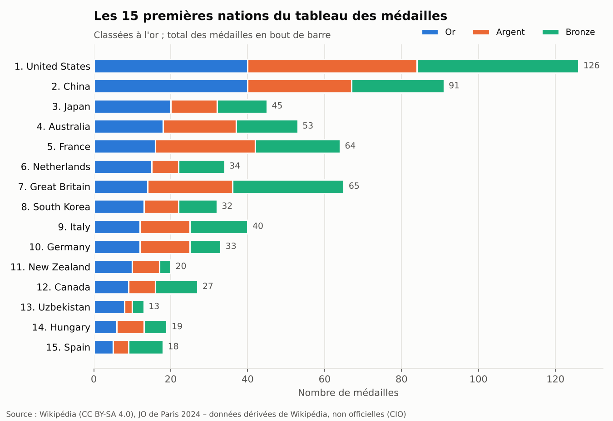
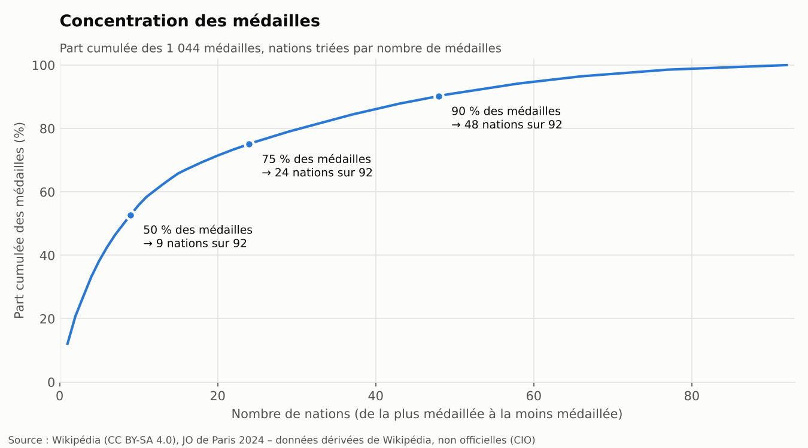
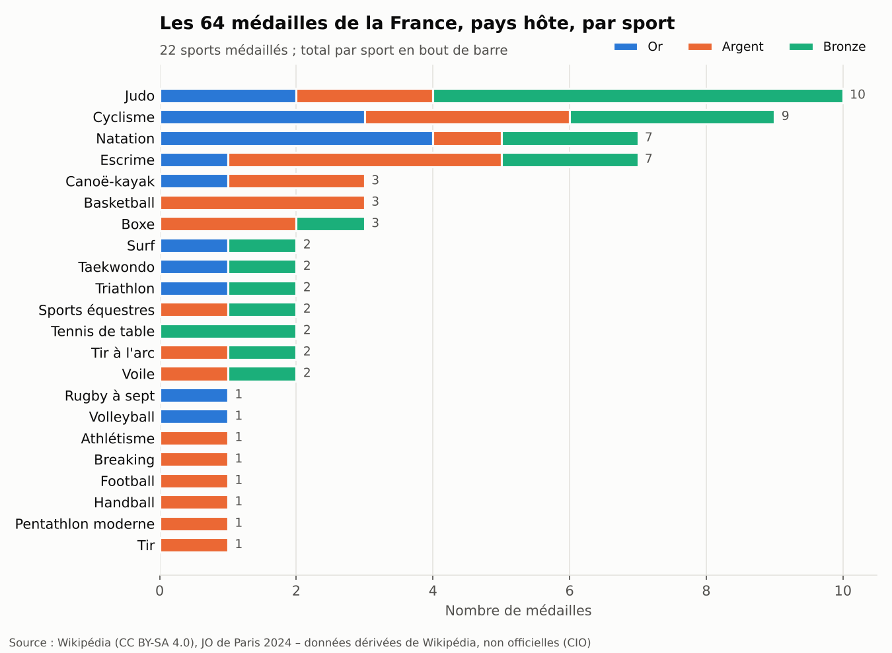

# Paris 2024 — Base de données & analyses SQL

**MySQL 8 · SQL analytique · Python · Visualisation de données**

Ce projet explore les Jeux olympiques de Paris 2024 sous deux angles : la **conception d'une base de données relationnelle** pour modéliser l'organisation des Jeux et **l'analyse SQL des médailles** à partir d'un jeu de données distinct.

## Le projet en chiffres

| Modélisation | Analyse | Visualisation |
|---|---|---|
| **23 tables**, **26 clés étrangères** | **10 requêtes analytiques**, **9 contrôles** | **3 graphiques** |

## Aperçu des résultats







Les analyses explorent notamment l'évolution des classements selon le mode de comptage, la concentration des médailles entre nations et les sports dans lesquels la France se distingue. [Voir les analyses SQL](#analyses) et [les résultats détaillés](#principaux-résultats).

## Deux parties complémentaires

| | Base de modélisation | Base d'analyse |
|---|---|---|
| Objectif | Représenter les athlètes, épreuves, sites, billets, sponsors et budgets | Étudier les médailles par nation, sport, épreuve et athlète |
| Données | **Simulées ou approximatives** | **Dérivées de Wikipédia**, non officielles au sens du CIO |
| Contenu | Script SQL original, MCD, audit de qualité | Schéma séparé, CSV, contrôles, requêtes et graphiques |

**À noter :** les données de la base initiale sont simulées et ne doivent pas être interprétées comme des statistiques sportives réelles. Les données du module d'analyse sont dérivées de Wikipédia (CC BY-SA 4.0), et non d'une publication officielle du CIO. Les sources, auteurs et transformations sont précisés dans [SOURCES.md](resultats_reels/SOURCES.md).

## Structure du dépôt

```text
JO_Paris_base_de_donnee.sql     Partie 1 : script d'origine (structure + données simulées)
diagrams/MCD.jpg                Partie 1 : modèle conceptuel de données
audit/audit_base_simulee.sql    Partie 1 : requêtes d'audit de la qualité des données
resultats_reels/
  sql/01_schema.sql             Partie 2 : création de la base et des tables
  sql/02_donnees.sql            Partie 2 : données (généré par le script d'extraction)
  sql/03_controles.sql          Partie 2 : contrôles de cohérence
  sql/04_analyses.sql           Partie 2 : 10 analyses
  donnees/*.csv                 Partie 2 : mêmes données au format CSV
  scripts/extraire_wikipedia.py Partie 2 : constitution du jeu de données (facultatif)
  scripts/graphiques.py         Partie 2 : génération des graphiques (facultatif)
  graphiques/*.png              Partie 2 : graphiques présentés ci-dessous
  SOURCES.md                    Partie 2 : sources, licence et modifications
```

## Prérequis

- MySQL 8.0 ou plus récent (le script d'origine utilise la collation `utf8mb4_0900_ai_ci`, propre à MySQL 8).
- Le client en ligne de commande `mysql`, ou phpMyAdmin pour la partie 1.
- Facultatif : Python 3.9+ pour régénérer les données, et matplotlib pour régénérer les graphiques.

Toutes les commandes ci-dessous se lancent depuis la racine du dépôt cloné. Ajouter `-p` (mot de passe) ou `-h` (hôte) selon votre installation.

---

## Partie 1 : base simulée

Base conçue pour modéliser l'organisation des Jeux : athlètes, délégations, disciplines, épreuves, résultats et classements, sites et sessions, spectateurs et billets, sponsors et budget. Elle compte 23 tables reliées par 26 clés étrangères (voir le [MCD](diagrams/MCD.jpg)).

### Installation

Le script est un export phpMyAdmin : il ne crée pas la base, il faut la créer avant l'import.

```bash
mysql -u root -e "CREATE DATABASE jeux_olympiques_2024 CHARACTER SET utf8mb4 COLLATE utf8mb4_0900_ai_ci"
```

```bash
mysql -u root jeux_olympiques_2024 < JO_Paris_base_de_donnee.sql
```

Avec phpMyAdmin : créer la base `jeux_olympiques_2024`, la sélectionner, puis importer `JO_Paris_base_de_donnee.sql` depuis l'onglet « Importer ».

### Audit de la qualité des données

Le fichier `audit/audit_base_simulee.sql` contient 10 requêtes en lecture seule qui repèrent les incohérences, sans rien modifier :

```bash
mysql -u root -t jeux_olympiques_2024 < audit/audit_base_simulee.sql
```

Principaux constats, obtenus avec ces requêtes :

| Requête | Constat |
|---|---|
| Q1 | 3 athlètes saisis deux fois (Léon Marchand, Simone Biles, Katie Ledecky) |
| Q2 | 1 date de naissance impossible (2024-03-03, avec nom et prénom inversés) |
| Q3 | 4 disciplines et 5 épreuves en double |
| Q4 | 1 épreuve datée hors de son événement (saut à la perche au 5 juillet 2024) |
| Q5 | Libellés de médaille non normalisés (`Or` / `OR`, `Argent` / `ARGENT`) |
| Q6 | 7 résultats enregistrés deux fois, car les records sont stockés comme des résultats supplémentaires |
| Q7 | 1 athlète dans une épreuve de l'autre sexe et 3 résultats où le pays de l'équipe diffère de celui de l'athlète |
| Q8 | 11 résultats dont la position ne correspond pas au classement, ou dont le classement est partagé entre deux épreuves |
| Q9 | 9 résultats sur 27 sans participation enregistrée ; 41 épreuves sur 53 sans aucun résultat |
| Q10 | 16 présences sans billet sur 38, et 37 billets sans présence sur 60 |

Ces constats tiennent surtout à la saisie des données d'exemple. Côté modèle, l'audit fait aussi ressortir plusieurs points : le pays de l'athlète est un texte libre et non une référence à la table `delegation`, la table `type_resultat` mélange le type de résultat (individuel, équipe) et les records, et aucune contrainte `UNIQUE` ou `CHECK` n'empêche les doublons. Le script d'origine est conservé tel quel ; ces constats servent de base à une éventuelle refonte.

---

## Partie 2 : résultats réels des JO de Paris 2024

### Source et licence

Les données proviennent de deux pages de Wikipédia en anglais, lues à une révision fixée : le **tableau des médailles** et la **liste des médaillés par épreuve**. Elles sont publiées sous licence **CC BY-SA 4.0**. Les fichiers dérivés (CSV, script SQL de données et graphiques) sont diffusés sous la même licence. Les révisions, les auteurs et les modifications apportées sont détaillés dans [`resultats_reels/SOURCES.md`](resultats_reels/SOURCES.md).

**Ces données sont dérivées de Wikipédia : ce ne sont pas des données officielles du CIO.** Elles n'ont pas été comparées à une publication du CIO. Leur cohérence interne est en revanche vérifiée : les médailles extraites épreuve par épreuve sont comparées au tableau des médailles publié sur la même source (voir [Contrôles](#contrôles-de-cohérence)). Dans ce module, la table `tableau_officiel` et le « rang publié » désignent ce tableau tel qu'il figure sur Wikipédia.

### Contenu

| Table | Lignes | Contenu |
|---|---:|---|
| `nation` | 92 | Délégations médaillées, dont les Athlètes individuels neutres et l'Équipe olympique des réfugiés |
| `tableau_officiel` | 92 | Tableau des médailles tel que publié sur Wikipédia (rang, or, argent, bronze, total) |
| `sport` | 35 | Sports selon le découpage de la source, avec leur nom français |
| `epreuve` | 329 | Épreuves, avec discipline et catégorie (Hommes, Femmes, Mixte, Ouvert) |
| `medaille` | 1 044 | Une ligne par médaille : 329 en or, 330 en argent, 385 en bronze |
| `athlete` | 2 013 | Médaillés, identifiés par leur page Wikipédia |
| `medaille_athlete` | 2 268 | Lien entre une médaille et les athlètes cités par la source (plusieurs pour une équipe) |

Les athlètes ne sont pas reliés directement à une nation : leur nation est celle des médailles qu'ils ont remportées.

### Comptage des médailles

Les 1 044 médailles sont des **médailles attribuées par épreuve**, comptées comme dans un tableau des médailles : une ligne de la table `medaille` par place récompensée et par nation.

**Pourquoi plus de médailles d'argent et de bronze que d'épreuves ?** Les 329 épreuves ont chacune exactement une médaille d'or, mais leur répartition varie (requête A8) :

| Répartition (or / argent / bronze) | Épreuves | Explication |
|---|---:|---|
| 1 / 1 / 1 | 271 | Cas général |
| 1 / 1 / 2 | 57 | 54 épreuves de lutte, judo, boxe et taekwondo, qui attribuent deux bronzes par règlement, et 3 bronzes partagés par des ex aequo |
| 1 / 2 / 0 | 1 | Argent partagé au 100 m brasse masculin, si bien que le bronze n'a pas été attribué |

On obtient donc 329 médailles d'or, 329 + 1 = **330** médailles d'argent et 329 + 57 − 1 = **385** médailles de bronze, soit 1 044 au total. Ces totaux sont ceux du tableau des médailles de la source (contrôles C1 et C8).

**Médailles par épreuve et médailles physiques.** Une médaille d'équipe (relais, sports collectifs, épreuves par équipes) compte pour **une** médaille dans les 1 044, alors que chaque membre de l'équipe reçoit une médaille physique. Les 1 044 médailles se répartissent ainsi :

- 760 sont rattachées à un seul athlète ;
- 284 sont rattachées à plusieurs athlètes, pour 1 508 liens.

La table `medaille_athlete` compte ainsi 2 268 liens athlète-médaille. Ce nombre **n'est pas** le nombre officiel de médailles physiques remises : il dépend des athlètes cités par la source. Par exemple, les nageurs de relais n'ayant couru que les séries y figurent, mais pas forcément tous les remplaçants des sports collectifs.

### Installation

```bash
mysql -u root < resultats_reels/sql/01_schema.sql
```

```bash
mysql -u root jo_paris_2024_resultats < resultats_reels/sql/02_donnees.sql
```

Le premier script crée la base `jo_paris_2024_resultats` et ses tables (en les recréant si elles existent déjà). Le second insère les données, sans aucun téléchargement.

### Contrôles de cohérence

```bash
mysql -u root -t jo_paris_2024_resultats < resultats_reels/sql/03_controles.sql
```

Les 9 contrôles renvoient chacun un nombre d'anomalies, qui vaut **0** sur les données livrées :

- **C1** : les totaux or, argent et bronze de chaque nation, recalculés épreuve par épreuve, égalent ceux du tableau des médailles ;
- **C2** : une seule médaille d'or par épreuve ;
- **C3** : au moins une médaille d'argent par épreuve ;
- **C4** : chaque médaille a au moins un athlète ;
- **C5** : un athlète n'est médaillé que pour une seule nation ;
- **C6** : aucun athlète n'est médaillé à la fois dans une épreuve masculine et dans une épreuve féminine, ce qui contrôle la catégorie déduite ;
- **C7** : un athlète ne reçoit pas deux médailles dans la même épreuve ;
- **C8** : les totaux généraux valent 329, 330 et 385 ;
- **C9** : le rang publié de chaque nation égale le rang recalculé (or, puis argent, puis bronze).

Ces contrôles ont été vérifiés en introduisant volontairement des erreurs dans une transaction annulée. Une nation modifiée, une couleur de médaille changée ou un athlète retiré ou déplacé est bien détecté.

### Analyses

```bash
mysql -u root -t jo_paris_2024_resultats < resultats_reels/sql/04_analyses.sql
```

Les 10 requêtes portent sur les médailles attribuées par épreuve, telles que définies ci-dessus (une médaille d'équipe compte pour une, sauf en A9, qui compte les médailles de chaque athlète). Elles utilisent jointures, agrégations conditionnelles, expressions de table communes (`WITH`) et fonctions de fenêtre (`RANK`, `DENSE_RANK`, `ROW_NUMBER`, `SUM() OVER`).

| Requête | Question | Techniques principales |
|---|---|---|
| A1 | Le classement change-t-il si l'on compte le total plutôt que l'or ? | `RANK()` sur deux critères, comparaison au rang publié |
| A2 | Combien de nations se partagent la moitié des médailles ? | Somme cumulée `SUM() OVER (ORDER BY …)` |
| A3 | Quel est le sport principal des 15 premières nations ? | `ROW_NUMBER() OVER (PARTITION BY …)` |
| A4 | Quelle nation domine chaque sport ? | `RANK()` par sport, ex aequo regroupés |
| A5 | Quelles nations sont les plus polyvalentes, ou les plus dépendantes d'un sport ? | Agrégation à deux niveaux, `DENSE_RANK()` |
| A6 | Où la France, pays hôte, a-t-elle remporté ses médailles ? | Rang dans chaque sport par fenêtre partitionnée |
| A7 | Quelle part des médailles vient des épreuves féminines ? | Agrégation conditionnelle, part du total par fenêtre |
| A8 | Quelles épreuves n'ont pas une médaille de chaque couleur ? | Détection des sports à deux bronzes et des ex aequo |
| A9 | Qui sont les athlètes les plus médaillés ? | Table d'association, `DENSE_RANK()` |
| A10 | Quelles nations transforment le plus leurs médailles en titres ? | Écart à une moyenne de référence |

### Principaux résultats

Les chiffres ci-dessous sont ceux renvoyés par les requêtes sur les données livrées. Les graphiques correspondants (A1, A2 et A6) figurent dans l'[aperçu des résultats](#aperçu-des-résultats).

- **Classement (A1)** : le rang recalculé à partir des épreuves est identique au rang publié pour toutes les nations classées. Compter le total des médailles plutôt que l'or modifie nettement le classement. La Grande-Bretagne passe de la 7ᵉ à la 3ᵉ place (65 médailles dont 14 en or) et le Brésil de la 20ᵉ à la 12ᵉ. À l'inverse, le Japon recule de la 3ᵉ à la 6ᵉ place. Les États-Unis et la Chine sont à égalité d'or (40) ; les États-Unis sont premiers grâce à l'argent (44 contre 27).
- **Concentration (A2)** : 3 nations totalisent un quart des médailles et 9 nations en totalisent la moitié, soit moins de 10 % des 92 délégations médaillées. Il en faut 24 pour 75 % des médailles et 48 pour 90 %.
- **Spécialisation (A3, A5)** : 34 des 126 médailles des États-Unis (27 %) viennent de l'athlétisme, et 19 des 53 médailles de l'Australie (36 %) de la natation. Le Japon a remporté 11 médailles en lutte, dont 8 en or. Les États-Unis sont médaillés dans 29 sports, la France dans 22 et la Chine dans 21. À l'opposé, les 11 médailles du Kenya viennent toutes de l'athlétisme.
- **Domination (A4)** : la Chine a remporté les 8 titres du plongeon et les 5 du tennis de table, et la Corée du Sud les 5 titres du tir à l'arc. Les Pays-Bas ont remporté les deux tournois de hockey sur gazon. En athlétisme, sport qui compte le plus de titres (48), les États-Unis en remportent 14, soit 29 %.
- **France (A6, A10)** : 64 médailles dans 22 sports. La France est la nation la plus médaillée en judo (10 médailles) et en escrime (7). Elle est deuxième en cyclisme (9 médailles) et a remporté 4 de ses 16 titres en natation. Avec 16 titres sur 64 médailles (25 %), sa part de titres est inférieure de 6,5 points à la moyenne de l'ensemble des médailles (31,5 %). La Nouvelle-Zélande a la part la plus élevée parmi les nations ayant au moins 15 médailles : 10 titres sur 20 médailles.
- **Épreuves féminines (A7)** : 45,8 % des médailles ont été attribuées dans des épreuves féminines, 48,1 % dans des épreuves masculines et 6,1 % dans des épreuves mixtes ou ouvertes. Parmi les 10 premières nations, la part des épreuves féminines va de 35,9 % pour la France à 61,8 % pour les Pays-Bas.
- **Ex aequo (A8)** : la lutte, le judo, la boxe et le taekwondo attribuent deux médailles de bronze dans chacune de leurs 54 épreuves. Quatre autres épreuves ont connu un ex aequo :
  - bronze partagé au saut en hauteur féminin ;
  - bronze partagé au K-2 500 m féminin ;
  - bronze partagé à la barre fixe masculine ;
  - argent partagé au 100 m brasse masculin, sans bronze attribué.
- **Athlètes (A9)** : Zhang Yufei (Chine, natation) est l'athlète la plus médaillée, avec 6 médailles (1 en argent, 5 en bronze). Léon Marchand suit avec 5 médailles, dont 4 en or. Les 6 athlètes ayant 5 médailles ou plus sont tous des nageurs.

### Méthodologie

1. **Téléchargement** : les deux pages sont lues à une révision fixée via l'API de Wikipédia, puis conservées dans un cache local non versionné.
2. **Extraction** (bibliothèque standard Python) : lecture des tableaux HTML et développement des cellules fusionnées, ce qui gère les épreuves de combat à deux bronzes. Chaque médaillé est rattaché à une nation par le lien « *Pays* at the 2024 Summer Olympics ». Les athlètes sont les autres liens de la cellule, et les ex aequo réunis dans une même cellule sont séparés.
3. **Catégorie d'épreuve** : elle est déduite, dans cet ordre :
   - du nom de l'épreuve (*Men's*, *Women's*, *Mixed*, *B-Boys*, *B-Girls*) ;
   - des intertitres de la page (*Men's events*, *Women's events*…) ;
   - de l'ordre des tableaux, pour la natation en bassin (hommes, femmes, mixte) et la course en ligne en canoë-kayak (hommes, femmes), vérifié sur les médaillés (par exemple, 50 m nage libre : Cameron McEvoy chez les hommes et Sarah Sjöström chez les femmes) ;
   - de règles explicites pour trois cas que ni le nom ni les intertitres ne précisent : sports équestres « Ouvert » (hommes et femmes concourent ensemble), gymnastique rythmique « Femmes », natation artistique (duo « Femmes », équipe « Ouvert », car le règlement l'ouvre aux hommes).

   On obtient 157 épreuves masculines, 151 féminines, 14 mixtes et 7 ouvertes.
4. **Contrôles bloquants** : le script s'arrête sans rien écrire si l'un des cas suivants se présente :
   - le nombre d'épreuves diffère de 329 ;
   - une épreuve n'a pas exactement une médaille d'or ;
   - une médaille n'a pas d'athlète ;
   - les totaux d'une nation diffèrent du tableau des médailles.
5. **Écriture** : fichiers CSV et script SQL d'insertion (`02_donnees.sql`), identiques d'une exécution à l'autre pour une même source.

Pour régénérer les données, Python 3.9+ suffit, sans dépendance. Le premier lancement télécharge les deux pages, puis le script réutilise le cache :

```bash
python3 resultats_reels/scripts/extraire_wikipedia.py
```

Pour régénérer les graphiques (nécessite matplotlib) :

```bash
python3 resultats_reels/scripts/graphiques.py
```

### Limites

- **Source non officielle** : les données sont dérivées de Wikipédia et n'ont pas été comparées à une publication du CIO. La concordance exacte avec le tableau des médailles de Wikipédia (contrôles C1, C8 et C9) garantit la cohérence interne des comptes, pas l'absence d'erreur dans la source elle-même.
- **Instantané** : les médailles reflètent la source au moment de l'extraction, y compris la réattribution du bronze du sol féminin en gymnastique (Ana Bărbosu à la place de Jordan Chiles). Une réattribution ultérieure, par exemple après un contrôle antidopage, ne serait pas prise en compte.
- **Reproductibilité de l'extraction** : la liste des médaillés reprend des sections des pages de chaque sport. Wikipédia affiche ces sections dans leur version actuelle, même pour une révision ancienne de la liste. Une nouvelle extraction peut donc différer légèrement ; les contrôles bloquants le signaleraient. Les fichiers versionnés font référence.
- **Périmètre** : seules les médailles sont disponibles. Les dates, sites, performances (temps, scores), âges et participants non médaillés ne le sont pas, et les nations sans médaille n'apparaissent pas. Aucune analyse rapportée à la population ou au nombre de participants n'est donc proposée.
- **Découpage des sports** : il suit la source (35 sports, par exemple le plongeon séparé de la natation), ce qui diffère du découpage officiel du CIO.
- **Catégories déduites** : la catégorie Hommes, Femmes, Mixte ou Ouvert est reconstituée par des règles documentées ci-dessus et contrôlée par C6. Ce n'est pas un champ de la source.
- **Athlètes** :
  - Ils sont identifiés par leur page Wikipédia. Deux homonymes (« Yang Liu », boxeuse et joueuse de hockey) restent donc distincts. Un même athlète lié à deux pages différentes a été fusionné une fois (Ancuța Bodnar) ; d'autres cas non détectés restent possibles.
  - Les noms sont ceux affichés dans la source.
  - Les nageurs de relais ayant seulement participé aux séries sont comptés comme médaillés, ce qui est conforme à l'attribution des médailles mais augmente leur nombre de médailles (A9).
- **Noms en anglais** : les noms des nations et des épreuves sont ceux de la source ; seuls les noms des sports sont traduits.

---

## Technologies

- MySQL 8 (SQL : jointures, CTE, fonctions de fenêtre, contraintes `CHECK`)
- phpMyAdmin (partie 1)
- Python 3, bibliothèque standard (extraction), et matplotlib (graphiques)

## Auteur

Ela Tissaoui
